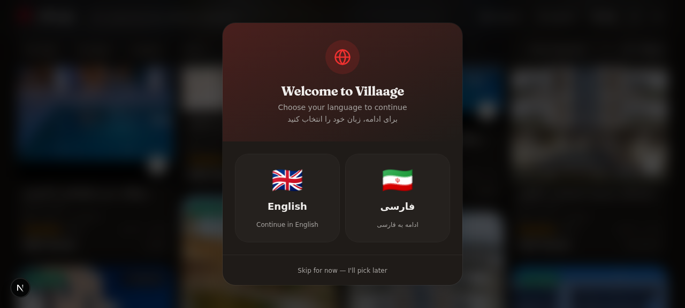
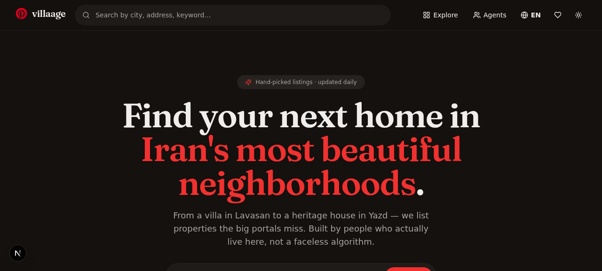
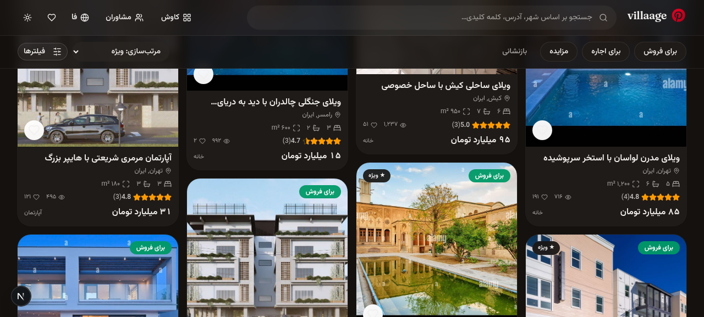
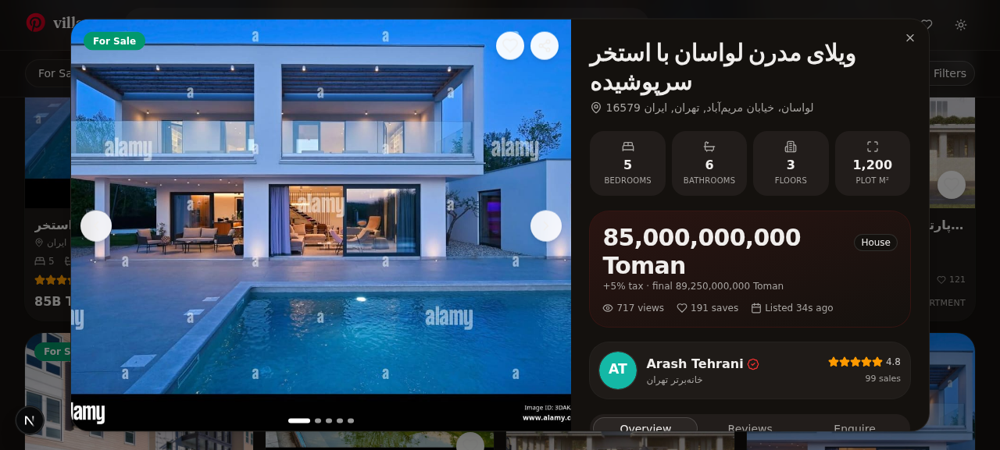
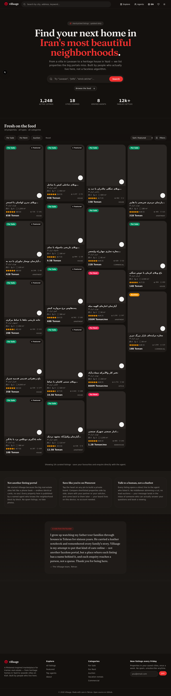

<div align="center">

# 🏡 Villaage

### A Pinterest-inspired real-estate marketplace for Iran

**From a villa in Lavasan to a heritage wind-catcher house in Yazd —
properties the big portals miss, listed by agents who know the neighborhood block by block.**

[](https://nextjs.org/)
[](https://www.typescriptlang.org/)
[](https://www.prisma.io/)
[](https://tailwindcss.com/)
[](LICENSE)

[Features](#-features) · [Screenshots](#-screenshots) · [Getting Started](#-getting-started) · [Tech Stack](#-tech-stack) · [API](#-api-reference) · [Contributing](#-contributing)

[فارسی](#-فارسی) · [English](#-english)

</div>

---

## 🇬🇧 English

### What is Villaage?

Villaage is a modern, bilingual (English / فارسی) real-estate marketplace inspired by Pinterest's visual discovery model. Instead of a phone-book list of identical cards, properties appear in a masonry grid of varying heights — each with hover overlays, save buttons, and agent profiles one tap away.

The project started as a rewrite of an open-source Django + React skeleton that had a near-empty frontend (`<h1>villaage</h1>`) and several real bugs in the data layer. It has since been rebuilt from scratch in Next.js 16 with a focus on craft, accessibility, and the kind of care a good real-estate agent brings to a viewing.

### ✨ Features

| | Feature | What it does |
|---|---|---|
| 🖼️ | **Pinterest masonry grid** | Properties flow in a responsive column layout with varying card heights, hover overlays, and touch-friendly save buttons. |
| 📁 | **Locally-hosted images** | All property photos are bundled in `public/images/` — **no external CDN, works without VPN**. 17 optimized images (2.1MB total) cycle across listings. Agent avatars are generated as inline SVGs (zero network requests). |
| 🌍 | **Full bilingual i18n** | English and Persian (فارسی) with a cookie-persisted locale. Switching languages updates `<html lang dir>` live — no reload. |
| ↔️ | **RTL support** | Every asymmetric utility converted to logical properties (`ps/pe/ms/me/start/end`). Icons flip, sheets slide from the correct side. |
| 🔤 | **Vazirmatn + Fraunces fonts** | Persian uses Vazirmatn; English uses Inter for body and Fraunces for display headings. Loaded via `next/font`. |
| 💰 | **Toman currency** | Prices stored and displayed in Iranian Toman with compact formatting (`85B Toman` / `۸۵ میلیارد تومان`) and Persian digits. |
| 🌙 | **Dark mode default** | Ships in a warm charcoal dark mode (not harsh black) via `next-themes`, with a one-tap toggle. |
| 🚪 | **First-visit language picker** | New visitors see a welcome modal with flag-based EN/FA selection. Choice is saved to a cookie — never shown again. |
| ❤️ | **Saved board** | Tap the heart on any pin to build a private board. Persisted in `localStorage` — no account needed. Badge counter on the header. |
| 🔍 | **Search & filters** | Full-text search, quick filter chips (For Sale / For Rent / Auction), advanced filter sheet (price slider, beds/baths, property type, city). |
| 📋 | **Property detail** | Photo gallery with prev/next + thumbnails, spec grid, agent card, tabs (Overview / Reviews / Enquire), share button. |
| ⭐ | **Ratings & reviews** | Buyers post reviews that auto-aggregate into the agent's rating. Animated list with optimistic UI. |
| 📨 | **Enquiry form** | Validated, posts directly to the listing agent. Includes mailto + tel deep links. |
| 👤 | **Agent profiles** | Browse all agents, click any to see their portfolio, ratings, and contact info. |
| 📱 | **Responsive** | Tested from 390×844 (iPhone) to 1440×900. Mobile uses bottom-sheets, desktop uses dialogs. |
| ♿ | **Accessible** | Semantic HTML, ARIA labels, keyboard-navigable cards, sr-only dialog titles, 44px touch targets. |

### 📸 Screenshots

<table>
  <tr>
    <td width="50%" align="center"><b>🚪 First-visit language picker</b></td>
    <td width="50%" align="center"><b>🌙 Dark mode home (warm charcoal)</b></td>
  </tr>
  <tr>
    <td></td>
    <td></td>
  </tr>
  <tr>
    <td align="center"><b>🌅 Persian RTL — dark mode</b></td>
    <td align="center"><b>📋 Property detail with gallery</b></td>
  </tr>
  <tr>
    <td></td>
    <td></td>
  </tr>
</table>

#### 🎬 Demo video

https://github.com/user-attachments/assets/demo-placeholder

> The demo shows: scrolling the masonry feed → opening a property detail → switching tabs (Overview → Reviews → Enquire) → closing → opening the saved board.

### 🚀 Getting Started

#### Prerequisites

- **Node.js 18+** or **Bun** (recommended — this repo uses Bun)
- **SQLite** (bundled, no separate install needed)

#### Installation

```bash
# 1. Clone the repository
git clone https://github.com/your-username/villaage.git
cd villaage

# 2. Install dependencies
bun install   # or: npm install

# 3. Set up the database
bun run db:push    # creates the SQLite file and schema

# 4. Seed with sample data (8 agents, 18 properties, 60 ratings)
bun run scripts/seed.ts

# 5. Start the dev server
bun run dev
```

The app runs on `http://localhost:3000`.

#### Environment

Create a `.env` file (already provided in the repo):

```env
DATABASE_URL=file:./db/villaage.db
```

### 🛠 Tech Stack

| Layer | Technology | Why |
|---|---|---|
| **Framework** | Next.js 16 (App Router) | Server components, streaming, file-based routing |
| **Language** | TypeScript 5 | End-to-end type safety |
| **Styling** | Tailwind CSS 4 + shadcn/ui | Logical properties for RTL, dark mode built-in |
| **Database** | Prisma 6 + SQLite | Type-safe queries, zero-config local DB |
| **State** | Zustand (favorites) + React Context (locale) | Persisted favorites, locale via cookie |
| **Animation** | Framer Motion | Card enter, modal transitions, toast badges |
| **Fonts** | Inter, Fraunces, Vazirmatn | Latin body, Latin display, Arabic script |
| **Icons** | Lucide React | Consistent, tree-shakeable |
| **Toasts** | Sonner | Locale-aware notifications |

### 📁 Project Structure

```
villaage/
├── prisma/
│   └── schema.prisma              # Agent, Property, Rating, Enquiry, PropertyView
├── public/
│   └── images/properties/        # 17 locally-hosted property photos (2.1MB total)
├── scripts/
│   ├── seed.ts                    # 8 Iranian agents, 18 properties, 60 ratings
│   └── optimize-images.mjs        # Resize/compress images script
├── src/
│   ├── app/
│   │   ├── layout.tsx             # Reads locale cookie → sets <html lang dir>
│   │   ├── page.tsx               # Single-page orchestrator
│   │   ├── globals.css           # Pinterest palette + masonry + RTL utilities
│   │   └── api/
│   │       ├── properties/       # List, detail, ratings, enquiries
│   │       └── agents/           # List, profile + portfolio
│   ├── components/
│   │   ├── language-switcher.tsx # Globe dropdown (EN / فارسی)
│   │   ├── site-header.tsx       # Sticky nav + footer
│   │   ├── theme-provider.tsx    # next-themes wrapper
│   │   └── property/
│   │       ├── hero.tsx
│   │       ├── filters-bar.tsx   # Quick chips + advanced sheet
│   │       ├── masonry-grid.tsx  # CSS columns masonry
│   │       ├── property-card.tsx # Pin with smart image fallback
│   │       ├── property-detail-dialog.tsx  # Gallery + tabs + forms
│   │       ├── saved-board-sheet.tsx       # Pinterest board metaphor
│   │       ├── agent-sheet.tsx             # Agents list + profile
│   │       └── testimonials.tsx            # Humanized social proof
│   └── lib/
│       ├── i18n/
│       │   ├── dict.ts           # ~150 keys × 2 locales
│       │   └── provider.tsx       # LocaleProvider + useI18n hook
│       ├── format.ts             # Toman formatting, Persian digits
│       ├── fav-store.ts          # Zustand persisted favorites
│       └── db.ts                 # Prisma client singleton
└── docs/
    └── screenshots/              # README images + demo video
```

### 🔌 API Reference

| Method | Endpoint | Description |
|---|---|---|
| `GET` | `/api/properties` | List properties with filters (`q`, `advertType`, `propertyType`, `minPrice`, `maxPrice`, `bedrooms`, `bathrooms`, `city`, `sort`, `limit`) |
| `GET` | `/api/properties/:id` | Property detail with agent, ratings, and view count incremented |
| `GET` | `/api/properties/:id/ratings` | List ratings for a property |
| `POST` | `/api/properties/:id/ratings` | Post a new review `{ reviewerName, reviewerEmail?, score (1-5), comment }` — auto-recomputes agent rating |
| `POST` | `/api/properties/:id/enquiries` | Submit an enquiry `{ name, email, phone?, message, moveDate? }` |
| `GET` | `/api/agents` | List all agents sorted by rating |
| `GET` | `/api/agents/:id` | Agent profile with their portfolio |

### 🗃️ Data Model

```prisma
Agent     →  name, email, phone, agency, bio, avatarUrl, verified, rating, salesCount
Property  →  title, description, advertType, propertyType, price (Toman), taxPercent,
             country, city, streetAddress, bedrooms, bathrooms, plotArea,
             coverPhoto + photo1-4, featured, views, savedCount
Rating    →  propertyId, agentId, reviewerName, reviewerEmail, score (1-5), comment
Enquiry   →  propertyId, agentId, name, email, phone, message, moveDate, status
```

### 🐛 Bugs Fixed from the Original Project

The original `tackselooli/villaage` Django + React project had these issues, all resolved in this rewrite:

1. **`PropertyPublishedManager(models.Model)`** — wrong base class. → Fixed with API-level `published = true` filtering.
2. **`objects = models.Manager`** — missing parentheses. → Prisma client correctly instantiated once.
3. **`save()` regenerated `ref_code` on every save** — → Now `refCode` is generated once via `@default(cuid())`.
4. **`tax` stored as `0.15` but used as a multiplier** — → Now stored as a percentage (0–100).
5. **`on_delete=models.DO_NOTHING`** on the agent FK — data integrity bug. → Proper `onDelete: Restrict` / `Cascade`.
6. **Empty React frontend** (`<h1>villaage</h1>`) — → Full marketplace UI.

### 🤝 Contributing

Pull requests are welcome. For major changes, please open an issue first to discuss what you'd like to change.

```bash
# Fork → branch → commit → PR
git checkout -b feat/your-feature
bun run lint        # ensure zero errors/warnings
git commit -m "feat: your feature"
git push origin feat/your-feature
```

### 📄 License

MIT — see [LICENSE](LICENSE).

---

<div align="center">

## 🇮🇷 فارسی

</div>

### ویلج چیست؟

ویلج یک بازارگاه املاک مدرن و دوزبانه (انگلیسی / فارسی) است که از مدل کشف بصری پینترست الهام گرفته است. به‌جای فهرستی مثل دفترچه تلفن از کارت‌های تکراری، ملک‌ها در یک شبکه ماسونری با ارتفاع‌های متفاوت ظاهر می‌شوند — هرکدام با روکش هوشمند، دکمه ذخیره و پروفایل مشاور در یک ضربه.

این پروژه ابتدا بازنویسی یک اسکلت متن‌باز جنگو + ریکت بود که فرانت‌اند تقریباً خالی داشت (`<h1>villaage</h1>`) و چند باگ واقعی در لایه داده داشت. از آن زمان با تمرکز بر صنعت، دسترسی‌پذیری و مراقبتی که یک مشاور خوب در یک بازدید به همراه دارد، از صفر با Next.js 16 بازسازی شده است.

### ✨ امکانات

| | امکانات | توضیح |
|---|---|---|
| 🖼️ | **شبکه ماسونری پینترست** | ملک‌ها در چیدمان ستونی واکنش‌گرا با ارتفاع‌های متفاوت، روکش هوشمند و دکمه ذخیره لمسی. |
| 📁 | **تصاویر محلی** | همه عکس‌های ملک در `public/images/` قرار دارند — **بدون CDN خارجی، بدون نیاز به VPN**. ۱۷ عکس بهینه‌شده (مجموع ۲.۱ مگابایت) بین ملک‌ها چرخش می‌کنند. آواتار مشاوران به‌صورت SVG درون‌خطی تولید می‌شوند (صفر درخواست شبکه). |
| 🌍 | **دوزبانه کامل** | انگلیسی و فارسی با ذخیره‌شده در کوکی. تغییر زبان `<html lang dir>` را زنده به‌روز می‌کند — بدون بازخوانی. |
| ↔️ | **پشتیبانی RTL** | هر ابزار نامتقارن به ویژگی‌های منطقی تبدیل شده (`ps/pe/ms/me/start/end`). آیکون‌ها برمی‌گردند، شیت‌ها از سمت درست می‌لغزند. |
| 🔤 | **فونت‌های وزیرمتن + فرونسس** | فارسی از وزیرمتن استفاده می‌کند؛ انگلیسی از اینتر برای متن و فرونسس برای عناوین. |
| 💰 | **ارز تومان** | قیمت‌ها به تومان با قالب‌بندی فشرده (`۸۵ میلیارد تومان`) و ارقام فارسی. |
| 🌙 | **حالت تاریک پیش‌فرض** | با یک ذغلت قابل تغییر. حالت تاریک با رنگ زغالی گرم (نه سیاه تند) عرضه می‌شود. |
| 🚪 | **انتخاب زبان در اولین بازدید** | بازدیدکنندگان جدید یک مودال خوش‌آمدگویی با پرچم‌های انگلیسی و فارسی می‌بینند. انتخاب در کوکی ذخیره می‌شود — دیگر نشان داده نمی‌شود. |
| ❤️ | **تخته ذخیره** | روی قلب هر پین ضربه بزنید تا تخته خصوصی بسازید. در `localStorage` ذخیره می‌شود — بدون نیاز به حساب. |
| 🔍 | **جستجو و فیلتر** | جستجوی متن کامل، چیپ‌های سریع، شیت فیلتر پیشرفته (اسلایدر قیمت، اتاق خواب، نوع ملک، شهر). |
| 📋 | **جزئیات ملک** | گالری عکس با ناوبری، جدول مشخصات، کارت مشاور، تب‌ها (نمای کلی / نظرات / استعلام). |
| ⭐ | **امتیاز و نظر** | خریداران نظراتی می‌گذارند که خودکار در امتیاز مشاور تجمیع می‌شود. |
| 📨 | **فرم استعلام** | اعتبارسنجی‌شده، مستقیم به مشاور ارسال می‌شود. شامل لینک‌های مستقیم ایمیل و تلفن. |
| 👤 | **پروفایل مشاور** | همه مشاوران را مرور کنید، روی هرکدام ضربه بزنید تا نمونه‌کارشان را ببینید. |
| 📱 | **واکنش‌گرا** | از ۳۹۰×۸۴۴ (آیفون) تا ۱۴۴۰×۹۰۰ تست شده. موبایل از شیت پایین، دسکتاپ از دیالوگ استفاده می‌کند. |
| ♿ | **دسترسی‌پذیر** | HTML معنایی، برچسب‌های ARIA، کارت‌های قابل ناوبری با کیبورد، اهداف لمسی ۴۴ پیکسلی. |

### 📸 تصاویر

<table>
  <tr>
    <td width="50%" align="center"><b>🌙 حالت تاریک (پیش‌فرض) — انگلیسی</b></td>
    <td width="50%" align="center"><b>🌅 فارسی RTL — حالت تاریک</b></td>
  </tr>
  <tr>
    <td></td>
    <td></td>
  </tr>
  <tr>
    <td align="center"><b>📋 جزئیات ملک با گالری</b></td>
    <td align="center"><b>🗺️ صفحه کامل (هیرو + فید + درباره + نظرات)</b></td>
  </tr>
  <tr>
    <td></td>
    <td></td>
  </tr>
</table>

### 🚀 شروع به کار

#### پیش‌نیازها

- **Node.js 18+** یا **Bun** (پیشنهادی)
- **SQLite** (همراه، نیازی به نصب جداگانه نیست)

#### نصب

```bash
# ۱. کلون کردن مخزن
git clone https://github.com/your-username/villaage.git
cd villaage

# ۲. نصب وابستگی‌ها
bun install   # یا: npm install

# ۳. راه‌اندازی دیتابیس
bun run db:push    # فایل SQLite و اسکما را می‌سازد

# ۴. پر کردن با داده نمونه (۸ مشاور، ۱۸ ملک، ۶۰ امتیاز)
bun run scripts/seed.ts

# ۵. اجرای سرور توسعه
bun run dev
```

برنامه روی `http://localhost:3000` اجرا می‌شود.

#### محیط

یک فایل `.env` بسازید (در مخزن موجود است):

```env
DATABASE_URL=file:./db/villaage.db
```

### 🛠 تکنولوژی‌ها

| لایه | تکنولوژی | چرا |
|---|---|---|
| **فریم‌ورک** | Next.js 16 (App Router) | کامپوننت‌های سرور، استریمینگ، مسیریابی فایل‌محور |
| **زبان** | TypeScript 5 | امنیت نوع سرتاسری |
| **استایل** | Tailwind CSS 4 + shadcn/ui | ویژگی‌های منطقی برای RTL، حالت تاریک داخلی |
| **دیتابیس** | Prisma 6 + SQLite | کوئری‌های امن از نظر نوع، دیتابیس محلی بدون پیکربندی |
| **وضعیت** | Zustand (علاقه‌مندی) + React Context (زبان) | علاقه‌مندی‌های پایدار، زبان از طریق کوکی |
| **انیمیشن** | Framer Motion | ورود کارت، انتقال مودال، نشان‌های تست |
| **فونت** | Inter, Fraunces, Vazirmatn | متن لاتین، عنوان لاتین، خط عربی |
| **آیکون** | Lucide React | سازگار، قابل درخت‌شکافی |
| **تست** | Sonner | اعلان‌های آگاه از زبان |

### 📁 ساختار پروژه

```
villaage/
├── prisma/
│   └── schema.prisma              # Agent, Property, Rating, Enquiry
├── scripts/
│   └── seed.ts                    # ۸ مشاور ایرانی، ۱۸ ملک، ۶۰ امتیاز
├── src/
│   ├── app/
│   │   ├── layout.tsx             # خواندن کوکی زبان → تنظیم <html lang dir>
│   │   ├── page.tsx               # ارکستراتور تک‌صفحه‌ای
│   │   ├── globals.css            # پالت پینترست + ماسونری + ابزارهای RTL
│   │   └── api/                   # مسیرهای API
│   ├── components/
│   │   ├── language-switcher.tsx  # منوی کشویی (EN / فارسی)
│   │   ├── site-header.tsx        # ناو چسبان + فوتر
│   │   └── property/              # کارت، گالری، فیلتر، شیت‌ها
│   └── lib/
│       ├── i18n/dict.ts           # ~۱۵۰ کلید × ۲ زبان
│       ├── format.ts              # قالب‌بندی تومان، ارقام فارسی
│       └── db.ts                  # سینگلتون Prisma
└── docs/screenshots/              # تصاویر README + ویدئوی دمو
```

### 🔌 مرجع API

| متد | مسیر | توضیح |
|---|---|---|
| `GET` | `/api/properties` | فهرست ملک‌ها با فیلترها |
| `GET` | `/api/properties/:id` | جزئیات ملک با مشاور و نظرات |
| `POST` | `/api/properties/:id/ratings` | ثبت نظر جدید (امتیاز مشاور خودکار به‌روزرسانی می‌شود) |
| `POST` | `/api/properties/:id/enquiries` | ارسال استعلام به مشاور |
| `GET` | `/api/agents` | فهرست همه مشاوران |
| `GET` | `/api/agents/:id` | پروفایل مشاور با نمونه‌کار |

### 🗃 مدل داده

```prisma
Agent     →  نام، ایمیل، تلفن، آژانس، بیو، آواتار، تأیید‌شده، امتیاز، تعداد فروش
Property  →  عنوان، توضیحات، نوع آگهی، نوع ملک، قیمت (تومان)، درصد مالیات،
             کشور، شهر، آدرس، اتاق خواب، حمام، مساحت، عکس‌ها، ویژه، بازدید
Rating    →  ملک، مشاور، نام نظردهنده، ایمیل، امتیاز (۱-۵)، نظر
Enquiry   →  ملک، مشاور، نام، ایمیل، تلفن، پیام، تاریخ نقل، وضعیت
```

### 🤝 مشارکت

پول‌ریکوئست‌هاwelcome هستند. برای تغییرات بزرگ، لطفاً اول یک issue باز کنید.

```bash
# فورک → شاخه → کامیت → PR
git checkout -b feat/your-feature
bun run lint        # اطمینان از صفر خطا
git commit -m "feat: your feature"
git push origin feat/your-feature
```

### 📄 لایسنس

MIT — به [LICENSE](LICENSE) مراجعه کنید.

---

<div align="center">

**ساخته‌شده با ❤️ در تهران**

[⬆ بازگشت به بالا](#-villaage)

</div>
