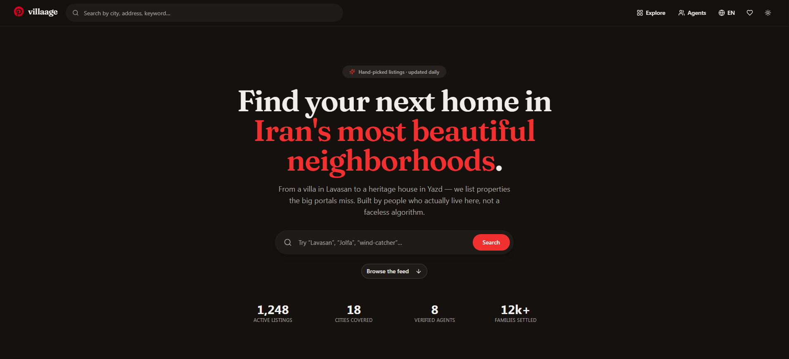
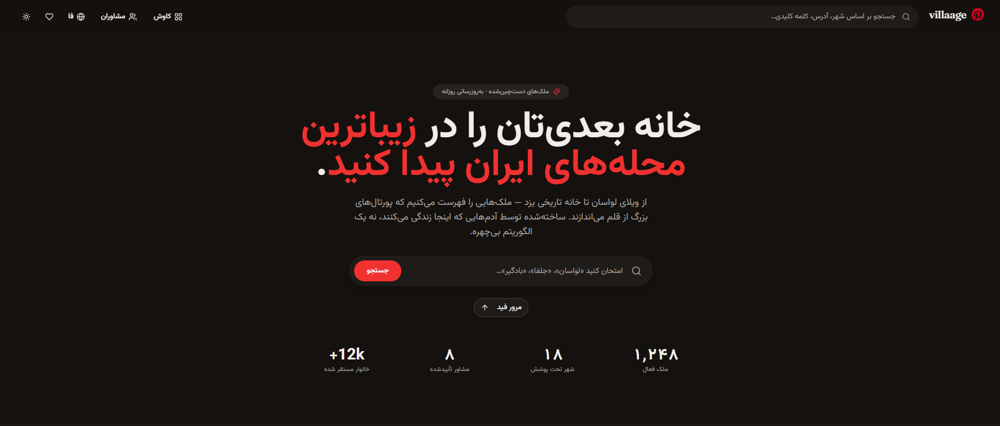
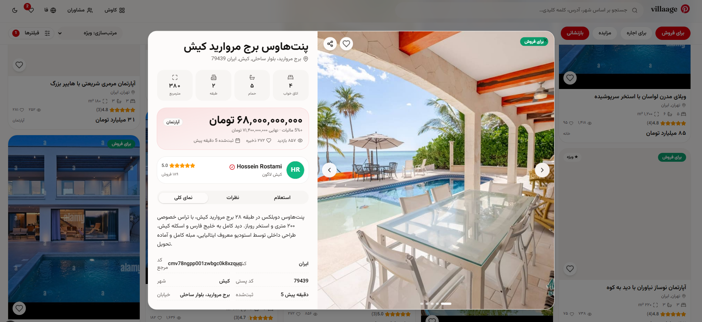

<div align="center">

# 🏡 Villaage

**A real-estate marketplace for Iran.**
Villas in Lavasan, wind-catcher houses in Yazd, apartments in Tehran —
listed by agents who actually know the block.

[](https://nextjs.org/)
[](https://www.typescriptlang.org/)
[](https://www.prisma.io/)
[](https://tailwindcss.com/)
[](LICENSE)

</div>

---

## What is this?

A bilingual (EN / فارسی) real-estate marketplace where properties scroll like Pinterest pins — masonry grid, hover overlays, save-to-board, agent one tap away. No phone-book lists. No CDN. No VPN.

Built on Next.js 16 + Prisma + SQLite. Runs on your laptop in 30 seconds.

---

## Screenshots

<p align="center">
  
  
  
</p>

---

## The cool bits

- 🖼️ **Masonry grid** — pins flow at different heights, hover, save, go
- 🌍 **Real bilingual** — EN + فارسی, RTL flips properly, locale saved in a cookie
- 📁 **Zero external CDN** — 17 photos (2.1 MB total) shipped locally, works offline
- ❤️ **Saved board** — heart a pin, it's yours. `localStorage`, no signup
- 🌙 **Warm dark by default** — charcoal, not void-black
- 🚪 **First-visit language picker** — flag modal, remembers your choice, never nags again
- ⭐ **Live ratings** — reviews roll into the agent's score automatically
- ♿ **Accessible** — keyboard nav, ARIA, 44px targets

---

## Run it

```bash
git clone https://github.com/your-username/villaage.git
cd villaage
bun install
bun run db:push          # SQLite file + schema
bun run scripts/seed.ts  # 8 agents · 18 properties · 60 ratings
bun run dev              # → http://localhost:3000
```

`.env`:

```env
DATABASE_URL=file:./db/villaage.db
```

---

## Stack

**Next.js 16** · **TypeScript** · **Tailwind 4 + shadcn/ui** · **Prisma + SQLite** · **Zustand** · **Framer Motion** · **Vazirmatn + Fraunces** · **Lucide**

---

## API (quick)

|        |                                                                 |
| ------ | --------------------------------------------------------------- |
| `GET`  | `/api/properties` · `/api/properties/:id`                       |
| `GET`  | `/api/agents` · `/api/agents/:id`                               |
| `POST` | `/api/properties/:id/ratings` · `/api/properties/:id/enquiries` |

---

## Data model

```
Agent     →  name, agency, avatar, rating, salesCount
Property  →  title, city, price (Toman), beds, baths, photos, featured
Rating    →  propertyId, agentId, score (1–5), comment
Enquiry   →  propertyId, agentId, contact, message, status
```

---

## Fixed from the original Django skeleton

Wrong `Manager` base class · missing parens on `models.Manager` · `ref_code` regenerated every save · `tax` treated as multiplier instead of percent · `on_delete=DO_NOTHING` · and an empty React frontend that was literally `<h1>villaage</h1>`. All gone.

---

```bash
bun install
bun run db:push
bun run scripts/seed.ts
bun run dev
```

---

<div align="center">

MIT · [LICENSE](LICENSE) · ⬆ [back to top](#-villaage)

</div>
